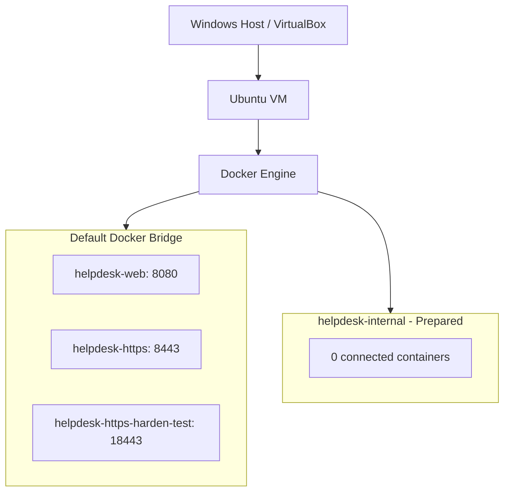

# Helpdesk Security Lab — Architecture

## Current Lab Architecture

## Current Deployment

- Ubuntu VirtualBox VM runs Docker Engine.
- Three Nginx containers are running.
- Published ports are bound to 127.0.0.1.
- helpdesk-https uses the default Docker bridge.
- All three running containers use the default Docker bridge.
- helpdesk-internal is a user-defined bridge network.
- helpdesk-internal has no connected containers.
- Backend and PostgreSQL are not yet deployed.

## Security Notes

- HTTPS and selected security headers were tested.
- Hardening was verified on a separate test container.
- Fixed credential fallback values were found in Compose.
- UFW is inactive.
- SSH listens on all IPv4/IPv6 interfaces.
- IA-HD07 remains partially verified.

## Evidence

See evidence/EV-HD-28-summary.md.
